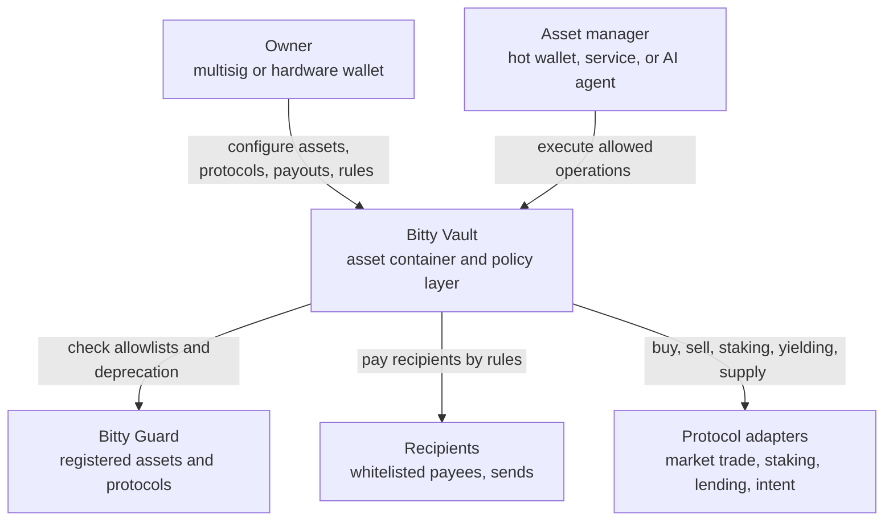

# Bitty Vault Contracts [](https://codecov.io/gh/BittyIO/vault)

Bitty Vault separates a wallet into two roles — Owner and Asset Manager. [BittyGuard](https://github.com/BittyIO/guard) protects users' funds from scams by allowing them to touch only whitelisted assets and protocols.

Each user creates their own vault, choosing assets and protocols from the [Bitty Protocol Store](https://github.com/BittyIO/protocol-store). Asset managers — whether AI agents or humans — can then execute DeFi operations safely, without risk of protocol frontend supply-chain attacks or the vault being drained.



## If your key is stolen: how the timelock protects the vault

### What the timelock is

The **timelock** is a waiting period you choose for your vault, from **1 to 30 days** (1 day until you
change it). It splits every settings change into two kinds:

- **Changes that make the vault safer happen immediately.** Lowering a limit, removing a permission,
  making the timelock longer.
- **Changes that make the vault riskier are only scheduled.** They are recorded onchain with the time
  they take effect, and nothing changes until the waiting period has passed. Adding a payee, raising a
  limit, adding an asset manager, making the timelock shorter, handing the vault to a new owner.

Draining a wallet means sending its money somewhere new. In a Bitty Vault, every route to "somewhere
new, in large amounts" goes through a risky change, and every risky change has to wait. A thief with
your key is therefore stuck in the open for at least one full timelock, while you can still act.

### What a thief with your owner key can actually do

| The thief tries to… | What happens |
| --- | --- |
| Send everything to their own address | A send to an address not on your whitelist is capped by the **daily send allowance**: a rolling 24 hours, in USD, at most $10,000, and it cannot be turned off. They get at most one allowance per day, not the vault. |
| Add their address to the whitelist, then send everything | The new entry waits out the timelock before it can be paid. |
| Raise the daily send allowance | Scheduled; waits out the timelock. |
| Shorten the timelock so the above go faster | Scheduled; it waits out the **current** timelock. |
| Remove your own safe addresses from the whitelist | Removals are scheduled too, so your escape routes stay usable. |
| Transfer the vault to a new owner | Scheduled; waits out the timelock. |
| Appoint their own asset manager | Scheduled; waits out the timelock. An asset manager can only use registered DeFi protocols on the vault's behalf anyway, never send money out. |
| Dump assets through a rigged pool | Market trades are checked against an oracle price and capped by the **daily market-trade loss allowance**. |
| Sell assets through a limit order | The proceeds always settle back into the vault, and only into assets Bitty's guard registers. The vault does not check a limit order's price; CoW Swap's solver competition fills it at the market price or better. |
| Upgrade the vault to malicious code | Only implementations registered by Bitty's guard, and only newer versions, are accepted, and not at all while the vault is locked. |
| Pay your existing whitelisted addresses | Allowed, but those are addresses you chose before the theft, so the money goes to you. |

Every scheduled change is visible onchain and in the app from the moment it is made, with the time it
would take effect.

### How you stop it

1. **Emergency lock.** One instant transaction. It cancels every scheduled change at once (new payees,
   raised limits, manager grants, ownership transfers), and while it is on, money can only leave to
   addresses that were already on your whitelist before the lock, or as limit orders that buy
   stablecoins for the vault itself. Your DeFi positions can still be unwound back into the vault.
2. **If the thief unlocks it.** The emergency lock can be lifted with the owner key, so a thief can
   lift it too. Doing so does not bring back anything the lock cancelled: they have to schedule
   everything again and wait out the full timelock again, and you can lock again at any moment.
3. **Forever lock.** Ends the race for good. It cannot be undone by anyone, and from then on money can
   only go to your whitelisted addresses. You must name one of them when you engage it, so a vault can
   never be locked forever with no way out.

### The most you can lose

Until you lock, a thief can take at most **the daily send allowance for each day**, plus market-trade
losses up to the **daily loss allowance**. Once you lock, ordinary sends stop entirely. A thief who wants more
than that has to wait out your timelock in public, and one lock cancels everything they have queued.

Three settings make that bound as tight as you want:

- **Whitelist a safe address of your own now** (a hardware wallet or exchange account). It is your
  escape route under a lock, and it has to have passed its own timelock *before* anything goes wrong.
- **Set the daily send allowance to what you actually spend.** It is the most a thief can take per day.
- **Pick a timelock longer than the time you might go without checking.** It is how long you have to
  notice.

So the safety of a Bitty Vault does not depend on your key never leaking. It depends on you noticing
within a window you chose yourself, and the damage before you do is capped by a limit you set.

## Risk over time

Where signing and UI risk is live — not just who holds the keys.

```
  EOA: risk from wallet to DeFi website, every time
  ──────────────────────────────────────────────────

  risk ████████████████████████████████████████████████████████████████
       wallet ──► connect ──► review tx ──► sign ──► DeFi frontend
       (entire path, every session; one bad signature = total loss)


  Safe Multi-sig: risk from the Safe website, every time
  ──────────────────────────────────────────────────────

  risk ████████████████████████████████████████████████████████████████
       open Safe UI ──► build tx ──► M signers review ──► execute
       (every approval; compromised UI or bad calldata can still drain funds)


  Bitty Vault: risk only at owner settings, and every loosening waits out a timelock
  ────────────────────────────────────────────────────────────────────────────────────

  risk ████████
       owner configures policy (allowlist, limits, roles)
       │  loosening changes wait 1–30 days; the owner can lock the vault and void them
       │
       └──► routine execution ───────────────────────────────────────►
            ░░░░░░░░░░░░░░░░░░░░░░░░░░░░░░░░░░░░░░░░░░░░░░░░░░░░░░░░░░
            asset manager operates within guard rules — no owner-key
            exposure on each trade, rebalance, or payout
```

EOA and Safe carry frontend and signing risk on **every** interaction. Bitty Vault concentrates that risk into **owner configuration** — the moments when policy changes. Day-to-day execution runs under onchain guard checks, so a compromised DeFi frontend cannot override what the owner already locked in. And because every change that loosens a rule waits out a timelock, even a stolen owner key cannot loosen anything on the spot.

## What protection costs

The security above is not free — but it is cheap. Because funds never leave the vault and every action is checked against the guard, a compromised DeFi frontend, a malicious relayer, or a leaked asset-manager key **cannot drain your money**. The price of that immunity is a little extra gas on each operation: instead of hitting the protocol directly, every call routes through the vault and its guard. The path is

```
asset manager ─► Vault (CALL) ─► DeFi facet (delegatecall) ─► DeFiLogic (delegatecall)
                                     │
                                     ├─► Guard (staticcall: is protocol deprecated?)
                                     └─► per-vault protocol clone (CALL ─► minimal-proxy delegatecall) ─► real protocol
```

Two things add gas versus a direct call:

1. **Dispatch plumbing** — ~4–5 extra cross-contract hops (fallback delegatecall, library delegatecall, guard staticcall, clone call, proxy delegatecall). About **12–20k gas, fixed**, the same for every protocol.
2. **Token custody** — funds live in the vault but the clone executes, so each operation routes the input token `vault → clone → protocol` and the receipt/output token back `protocol → clone → vault`: typically **2 extra ERC-20 transfers per operation** (~25–50k each). This is the dominant cost.

Estimated extra gas per operation (derived from the call graph and standard mainnet opcode/ERC-20 costs, not a live benchmark). USD assumes **ETH = $1,900**:

| Protocol | Operation | Extra gas vs. direct | @ ~0.045 gwei (now) | @ 3 gwei (normal) |
| --- | --- | --- | --- | --- |
| Uniswap V3 | market sell / buy | ~85k | $0.007 | $0.48 |
| Aave V3 | supply / withdraw | ~95k | $0.008 | $0.54 |
| Lido | stake | ~82k | $0.007 | $0.47 |
| Sky (sUSDS) | stake / unstake | ~75k | $0.006 | $0.43 |
| CoW Swap | place limit / TWAP order | ~110k | $0.009 | $0.62 |

Fractions of a cent today, and well under a dollar even at normal gas — the cost of a single trade. Weigh that against the alternative: with an EOA or a Safe, one bad signature on a compromised frontend can take **everything**. A few cents of gas per operation is what it costs to make that impossible.

## Deployed addresses

Live on Ethereum, Base, Arbitrum, Robinhood Chain and Sepolia. These are at the **same address on every chain**:

| Contract | Address |
| --- | --- |
| Guard | `0x000000000F5fcD35885BfE4c700042cE7cb39554` |
| Factory | `0x3d7Ed3cD011B423dd11BE280BF926667CAf0F120` |
| Forwarder | `0xD6013C5e339cd3546c0c7E86c306554a63FbAa6F` |

The vault implementation the guard currently serves, version **1.0.1**:

| Chain | Vault implementation |
| --- | --- |
| Ethereum, Arbitrum, Robinhood Chain | `0x8f428E7eD2Bf0D85E317679083545cA08F57Fc69` |
| Base | `0x5A441764E6970216443d1eFb7b30e58040CBFC0a` |
| Sepolia | `0x3DdE7d1898818C14485193e2CF2d048674dAeF14` |

The factory and the forwarder are the addresses to integrate against; both are fixed and the same on
every chain. A vault's own address follows from its owner alone (`factory.vaultAddress(owner)`), so it
is knowable before the vault exists and does not move when a new implementation ships — see
[Addresses that must never move](./dev.md#addresses-that-must-never-move). The implementation is
whatever the guard names as latest (`guard.latestImplementation(1)`); vaults upgrade onto it.

## Development

Build, test, deploy, and verify instructions live in [dev.md](./dev.md).

## License

AGPL-3.0-only
